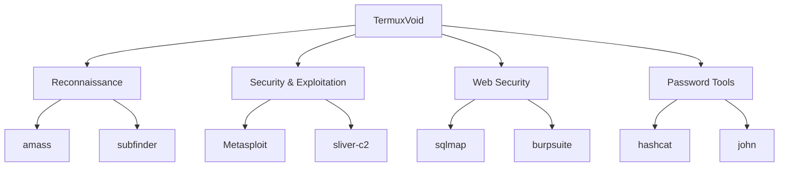

<div align="center">
  <a href="https://termuxvoid.github.io/">
    
    <h1>TermuxVoid APT Repository</h1>
  </a>
  <p><b>Unofficial APT repository: 250+ security and utility tools for Termux</b></p>

  <div>
    <a href="https://github.com/TermuxVoid/repo/stargazers">
      
    </a>
    <a href="https://github.com/TermuxVoid/repo/blob/main/LICENSE">
      
    </a>
    <a href="https://github.com/TermuxVoid/repo/issues">
      
    </a>
  </div>
</div>

## Table of Contents

- [Project Overview](#project-overview)
- [Prerequisites](#prerequisites)
- [Security & Transparency](#security--transparency)
- [Quick Installation](#quick-installation)
- [Pacman Users](#pacman-users)
- [Featured Tools](#featured-tools)
- [AI Tools](#ai-tools)
- [Legal & Disclaimer](#legal--disclaimer)
- [Frequently Asked Questions](#frequently-asked-questions)
- [Support & Community](#support--community)
- [Contribution & Support](#contribution--support)

---

## Project Overview

**TermuxVoid** is an unofficial, community-maintained APT repository for Termux. It packages **250+ security, reverse-engineering, Android, and utility tools**, many of which are not consistently packaged in the official Termux repositories. Installation happens on your device: depending on the package, the install script may compile from source, install dependencies, or download an upstream release binary. The package script is the source of truth.

The repository is intended for security researchers, students, and developers who understand the risks of running dual-use tooling on a personal device.

> [!NOTE]
> These packages are often excluded from official repositories because of size, dependencies, licensing, or security-policy concerns. Review each package script and its upstream project before installing.

## Prerequisites

- **Termux** installed from [F-Droid](https://f-droid.org/en/packages/com.termux/) (recommended) or GitHub.
- **Android 7 or newer** and **several GB of free storage** for large tools (Flutter, Android SDK, Ghidra, Metasploit, and similar).
- **Working internet access** for package downloads.
- **No root for most tools**, but some require root, ADB, or device-specific features. Check the package script and dependencies.
- **Accounts or API keys** for some AI and cloud tools. These tools may send data to third-party services.

## Security & Transparency

TermuxVoid is unofficial and community-maintained. Package definitions and lifecycle scripts are published here so you can inspect what runs on installation and removal. Installation scripts execute with your user permissions; read them before installing anything.

Each package lives in `packages/<name>/` with this layout:

- `control` — metadata (name, version, dependencies, description).
- `preinst` — pre-install checks, where present.
- `postinst` — installation work such as compiling, downloading, or linking.
- `postrm` — cleanup on removal, where present.

Some packages also ship a `data/` tree with files placed under `$PREFIX`.

### What packages do — and do not — change

- Package scripts do not permanently modify `$PATH`, `$HOME`, `$PREFIX`, or other Termux environment variables.
- Most tool packages do not alter existing Termux configuration. Packages whose stated purpose is shell styling, themes, desktop environments, or similar customization may create or change relevant configuration files.
- Removal scripts are intended to remove files created by the package. They cannot restore user changes made after installation, so back up configuration before installing customization packages.
- Some packages create symlinks or wrapper scripts in `$PREFIX/bin`. Review the script for details.

### Install-time downloads and integrity

Some packages compile from source on your device; others download prebuilt upstream binaries. Fixed-version downloads are checked with pinned SHA-256 hashes where upstream provides a stable artifact. Git clones, mutable URLs, pip/gem installs, and upstream installers are not hash-pinned. Where a SHA-256 check exists, a mismatch aborts installation.

A checksum protects against corrupted or swapped downloads. It does not protect against a compromised upstream account, a malicious upstream release, or a compromised repository signing key. Some packages bundle third-party loaders or patched binaries (for example, Burp Suite Professional); these may violate software licenses and carry additional malware risk. There is no warranty that any package is safe or suitable for your device.

APT repository metadata is distributed with a GPG signature (`InRelease`), and `install.sh` installs the TermuxVoid key under `$PREFIX/etc/apt/trusted.gpg.d/`.

### Before you install

1. Read the package metadata and lifecycle scripts (and any data archive).
2. Check every download URL, Git repository, package-manager command, and configuration change.
3. Review the upstream project, its license, and its privacy/security posture.
4. Use a test device or isolate sensitive data when trying unfamiliar tools.
5. Use security and surveillance tools only on systems, accounts, and data you own or are explicitly authorized to test.

Don't trust — verify. See [SECURITY.md](SECURITY.md) for the security policy and [CONTRIBUTING.md](CONTRIBUTING.md) for the package layout.

## Quick Installation

Run the installer in Termux to add the repository:

```bash
curl -sL https://github.com/termuxvoid/repo/raw/main/install.sh | bash
```

> [!WARNING]
> Piping a remote script directly to `bash` executes it immediately. For maximum transparency, download and inspect `install.sh` first, then run it locally.

Once the repository is added, install tools with:

```bash
# Refresh package lists and upgrade installed packages
pkg update

# Install any tool
pkg install <tool-name>

# Example
pkg install metasploit-framework
```

> [!TIP]
> The installer also installs **tvpkg**, the TermuxVoid package manager. Launch it with **`tvpkg`** (alias **`tvp`**) for an interactive TUI to browse, filter, install, and remove TermuxVoid tools.

> [!TIP]
> To refresh package lists later, run `pkg update`. Search with `pkg search <tool-name>`.

> [!NOTE]
> Removing the TermuxVoid repository does not remove packages you already installed. Use the package manager to remove individual packages; see the [uninstall instructions](#how-do-i-uninstall-the-termuxvoid-repository).

## Pacman Users

Running a pacman-based Termux? The same package set is also available from our Pacman repository:

- Repository: [github.com/termuxvoid/pacman-repo](https://github.com/termuxvoid/pacman-repo)
- Installer: `curl -sL https://github.com/termuxvoid/pacman-repo/raw/main/install-repo.sh | bash`

The package sets are kept in sync. Use the [Pacman README](https://github.com/termuxvoid/pacman-repo#readme) for that package manager's commands.

## Featured Tools

Examples from the catalog:

<div align="center">

| Tool | Category | Description |
| :--- | :--- | :--- |
| **Metasploit Framework** | `Security & Exploitation` | Penetration testing framework. |
| **Burp Suite** | `Web Security` | Web application security testing platform (Community Edition). |
| **Ghidra** | `Security & Exploitation` | Software reverse-engineering suite. |
| **THC Hydra** | `Networking` | Parallelized login cracker. |
| **SQLMap** | `Web Security` | SQL injection detection and exploitation tool. |

</div>

<details>
<summary><b>View package-group diagram</b></summary>



</details>

<div align="center">
  <a href="assets/PACKAGES.md">
    
  </a>
</div>

## AI Tools

AI tools may require accounts, API keys, or paid plans and may send prompts, code, or other data to third-party providers. AI output can be wrong; review generated code before running it. The catalog lists every AI package.

| Tool | Description |
| :--- | :--- |
| **9router** | Gateway between your tools and AI providers |
| **antigravity-cli** | AI coding assistant (glibc wrapper for Termux) |
| **claude-code** | Claude Code — AI coding assistant by Anthropic |
| **codex-cli** | Codex CLI — AI coding agent (npm version) |
| **copilot-cli** | GitHub Copilot CLI |
| **freebuff** | AI coding agent for the terminal |
| **hermes-agent** | AI coding assistant and workflow automation tool |
| **jcode** | Terminal coding agent harness |
| **kimi-code** | AI coding assistant for the terminal |
| **laudacode** | Lightweight AI coding agent for your terminal |
| **mimocode** | AI coding agent (glibc wrapper for Termux) |
| **mmx-cli** | CLI for MiniMax AI |
| **openclaude** | Open-source coding-agent CLI for cloud and local LLMs |
| **opencode** | AI-powered coding assistant |
| **termux-ai** | Interactive AI assistant for Termux |
| **utim-cli** | AI-powered unified terminal intelligence manager |

## Legal & Disclaimer

These tools are provided for **educational, research, and authorized security testing only**. You are responsible for complying with applicable laws, platform terms, and authorization requirements. Unauthorized access, interception, disruption, or data exfiltration is illegal. The maintainers accept no liability for misuse, damage, or data loss.

## Frequently Asked Questions

<details>
<summary><b>Are these tools safe to use on a personal device?</b></summary>

No package is guaranteed safe. These are powerful, dual-use tools. Some compile from source, some install dependencies, and some download prebuilt upstream binaries. Fixed-version downloads are checked with pinned SHA-256 hashes where a stable upstream artifact exists; git clones, mutable URLs, pip/gem installs, and upstream installers are not hash-pinned. Read the package scripts and the upstream source before installing, and use a test device or isolated environment where possible.

</details>

<details>
<summary><b>Are these tools legal to use?</b></summary>

They are intended for legal security research and authorized testing. Always obtain explicit permission before testing systems, accounts, or networks you do not own. Some tools may also violate platform terms or local law even when used on your own accounts.

</details>

<details>
<summary><b>Do these packages collect or send data?</b></summary>

Some do. AI tools, OSINT services, Telegram-based tools, phishing/surveillance utilities, and cloud integrations may send data to third parties. Read the package script and the upstream project's privacy policy. Do not feed secrets, credentials, or personal data to tools you do not trust.

</details>

<details>
<summary><b>Why aren't these in the official repo?</b></summary>

Many are large, have complex dependencies, or are excluded for licensing or security-policy reasons. Some may be available in other community repositories; check before installing duplicates.

</details>

<details>
<summary><b>How often are tools updated?</b></summary>

Updates follow upstream releases and reported issues. There is no fixed schedule or response-time guarantee; security-relevant fixes are prioritized when maintainers are available.

</details>

<details>
<summary><b>How do I request a new package?</b></summary>

Open a **[GitHub Issue](https://github.com/TermuxVoid/repo/issues)** or contact us on Telegram: **[Telegram @nullxvoid](https://telegram.me/nullxvoid)**. Email: **[termuxvoid@gmail.com](mailto:termuxvoid@gmail.com)**.

</details>

<details>
<summary><b>How do I report a broken package?</b></summary>

Open an issue on **[GitHub](https://github.com/TermuxVoid/repo/issues)** with the tool name and error output. Fixes depend on maintainer availability.

</details>

<details>
<summary><b>How do I uninstall the TermuxVoid repository?</b></summary>

To remove the repository source and signing key:

```bash
curl -sL https://github.com/termuxvoid/repo/raw/main/uninstall.sh | bash
```

This refreshes the package database and does **not** remove packages you already installed.

</details>

<details>
<summary><b>I get a "package not found" error — what should I do?</b></summary>

Run `pkg update` after adding the repository, then search with `pkg search <tool-name>`. If the tool still does not appear, check the **[full package list](assets/PACKAGES.md)** for the exact package name.

</details>

<details>
<summary><b>Is this repository affiliated with Termux or F-Droid?</b></summary>

No. TermuxVoid is an independent, unofficial community project. Report TermuxVoid package issues here, not to the Termux or F-Droid maintainers.

</details>

## Support & Community

Join our community of security researchers and Termux users.

<div align="center">
  <a href="https://telegram.me/nullxvoid">
    
  </a>
  <a href="https://youtube.com/@alienkrishnorg">
    
  </a>
  <a href="https://github.com/TermuxVoid/repo">
    
  </a>
</div>

---

## Contribution & Support

- Star the repository to show your support.
- Report bugs responsibly via Issues.
- Share it with people who understand the legal and security risks.
- Read [CONTRIBUTING.md](CONTRIBUTING.md) before opening a pull request.

[View Complete Package Catalog »](assets/PACKAGES.md)

<div align="center">
  <sub>Built for Termux by <a href="https://github.com/Anon4You">Alienkrishn</a> | Unofficial community project; review package scripts before installing.</sub>
</div>
